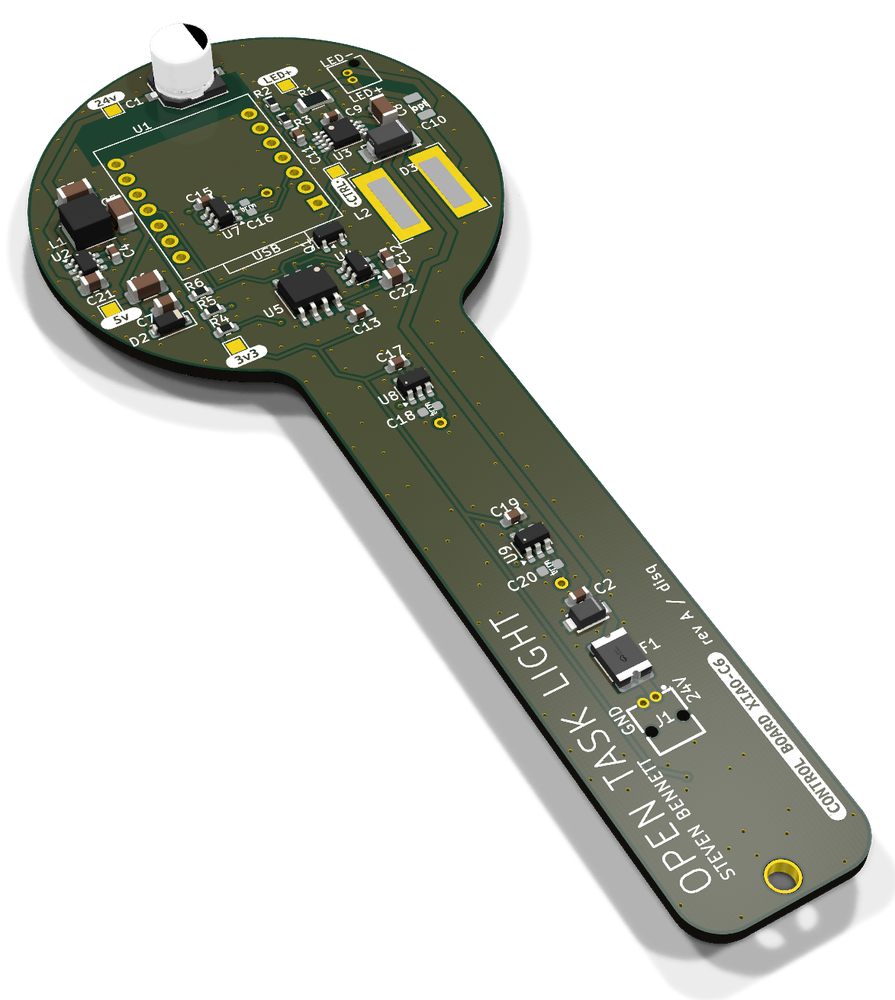
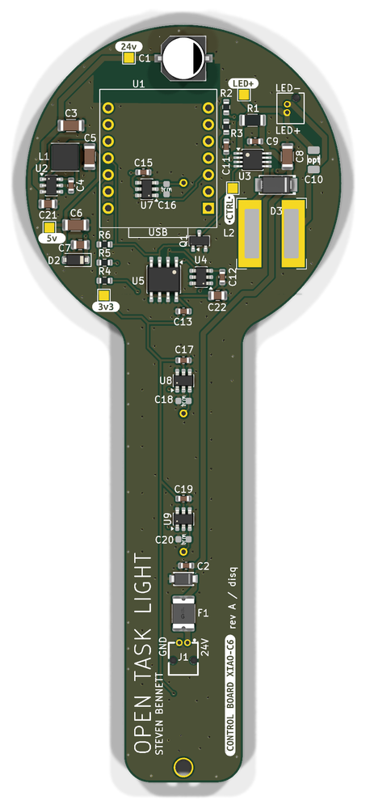
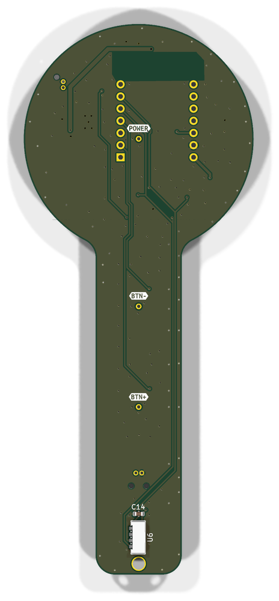
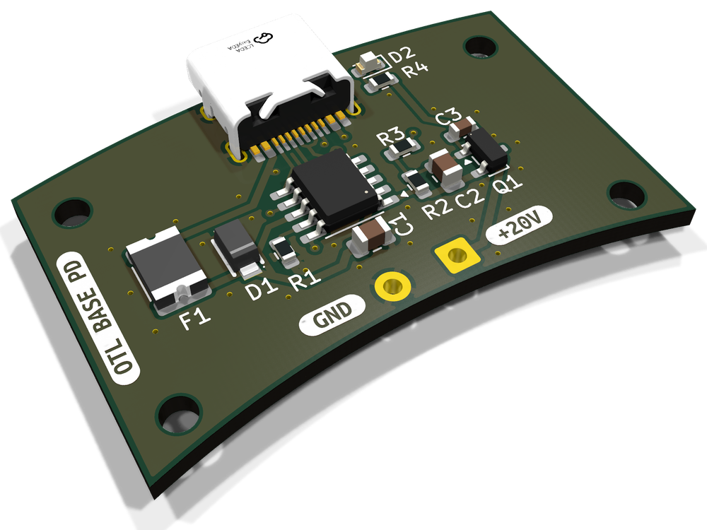
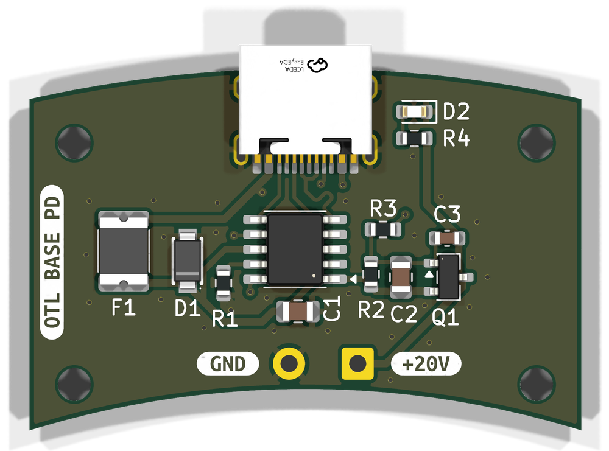
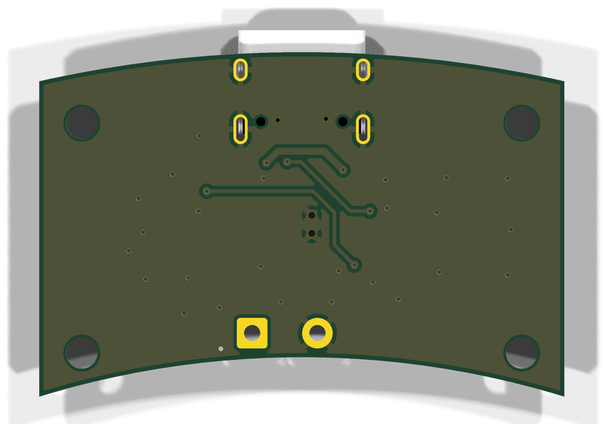

# Electronics

## ⚠️ USE AT YOUR OWN RISK

These boards run from 20-24 V and drive a high-power LED. Build and use them at your own risk, and check everything before you power them up.

Two KiCad 10 boards that share this folder's libraries:

| Board | What it does |
|---|---|
| [Control board](#control-board-otl-control-board) (`OTL-Control-Board.*`) | Replaces the V2 board in the lamp head: LED driver, touch buttons, light and temperature sensors, run by a Seeed XIAO ESP32-C6 with the [ESPHome firmware](../esphome/). |
| [USB-PD base board](#usb-pd-base-board-otl-base-pd) (`OTL-Base-PD.*`) | Sits in a pocket in the [freestanding base](../mechanical/README.md#freestanding-base-for-the-usb-pd-board) and powers the lamp at 20 V from a USB-C charger, instead of the 24 V power supply. |

| File | What it is |
|---|---|
| `*.kicad_pro`, `*.kicad_sch`, `*.kicad_pcb` | The KiCad projects |
| `*-schematic.pdf` | Schematics |
| `*-BOM.csv`, `*-CPL-JLC.csv` | BOM and placement file for JLCPCB assembly. The BOM doubles as a shopping list. |
| `fab/` | Gerbers and drill files, zipped for ordering |
| `bom/ibom.html`, `bompd/ibom.html` | Interactive BOMs, for hand assembly |
| `lib/`, `EasyEDA.*` | Symbols, footprints and 3D models the projects use |

## Control board (OTL-Control-Board)

The outline, mounting hole, connectors, touch spring pins, light sensor and module socket are where V2 has them, so it drops into the upstream head.

| Angled | Top | Bottom |
|:---:|:---:|:---:|
|  |  |  |

KiCad renders. The XIAO, the LED connector (J2), the spring pins and L2 have no 3D model, so they show as bare pads and holes.

| | V2 | This board |
|---|---|---|
| Controller | Adafruit QT Py ESP32-S2, CircuitPython | Seeed XIAO ESP32-C6, ESPHome |
| LED driver | RECOM RCD-24 module | AL8860 buck, 667 mA max |
| 5 V supply | RECOM R-78K5.0 module | AP63205 buck |
| Dimming | 8-bit DAC, about 90 steps | MCP4725 12-bit DAC, about 3,600 steps |
| Temperature | TMP75 | TMP1075, which also cuts the LED in hardware |
| Light sensor | VEML7700, looking sideways | VEML7700, looking straight up through the window |
| Touch | ESP32-S2 touch pins | 3x TTP223 (the ESP32-C6 has no touch pins) |
| Input protection | 1.1 A PTC | 1.5 A PTC or 2 A fuse |

### Power-up behaviour

The LED stays off at power-up until the firmware has configured the board, so a board without firmware looks dead. It also goes off in hardware above 56 °C, even if the ESP32 has crashed, and comes back below 50 °C. If the temperature sensor is missing or can't be configured, the lamp stays off.

### Pin map (XIAO)

| XIAO | GPIO | Use |
|---|---|---|
| D1 | 1 | Touch up |
| D2 | 2 | Touch power |
| D3 | 21 | Touch down |
| D4 / D5 | 22 / 23 | I2C SDA / SCL: MCP4725 (0x60), TMP1075 (0x48), VEML7700 (0x10) |
| D10 | 18 | Over-temperature alert from the TMP1075 |
| D0, D6-D9 | 0, 16, 17, 19, 20 | Free. D6 is the boot log's serial output. |

### Notes

- Not assembled by JLC: the XIAO, its sockets and the Mill-Max 807 spring pins.
- U6 (light sensor) and C14 are on the back.
- The XIAO sits on low-profile sockets (2x Samtec CES-107-01-G-S, as on V2). After soldering its header pins, pull the plastic spacer off them, so the XIAO sits about 2 mm lower and clears the LED brackets, and trim the pins to about 4.6 mm. Standard sockets are too tall for the head.
- F1: 1812 PTC or Littelfuse 0466002 1206 fuse.
- Alternates the footprints take: TTP223-BA6-TD (U7-U9), FNR8040 (L2), any 47 µF 50 V 6.3 mm can up to about 6 mm tall (C1).
- Test points: TP4 CTRL, TP5 +24 V, TP6 +5 V, TP7 +3V3, TP8 LED+. 100 mV across R1 (TP5 to TP8) is the full 667 mA.
- Firmware: [`../esphome/`](../esphome/README.md#flashing).

## USB-PD base board (OTL-Base-PD)

USB-C in, 20 V out to the lamp's barrel jack through a short lead. It sits in a pocket in the [reworked freestanding base](../mechanical/README.md#freestanding-base-for-the-usb-pd-board).

| Angled | Top | Bottom |
|:---:|:---:|:---:|
|  |  |  |

- U1 (CH224A) asks the charger for 20 V. Q1 switches the output on only once the charger has agreed, so the lamp gets nothing during negotiation or from a charger without 20 V.
- The green LED next to the USB-C lights once the output is on. It shows through a hole in the top of the base.
- The input is fused (F1) and clamped (D1).
- The charger needs a 20 V profile: every charger over 45 W has one, and most 30 W ones do. The lamp draws about 0.75 A.

### Notes

- 1.6 mm board: the pocket and the USB-C height assume it.
- The head runs straight from 20 V. The CXB1512 18 V class LED (17.2 V typical, 19 V max) works.
- F1: same dual footprint as on the control board.
- Q1: SQ2319CES or AO3407A. Not the AO3401A or other ±12 V-gate P-FETs: the gate sees up to about 19.5 V when the TVS clamps.
- J2: wire pads for the lead, square +20 V, round GND, up to 0.5 mm².
- Mounting: 4x M2x6 cap-head machine screws into the pocket's bosses.
