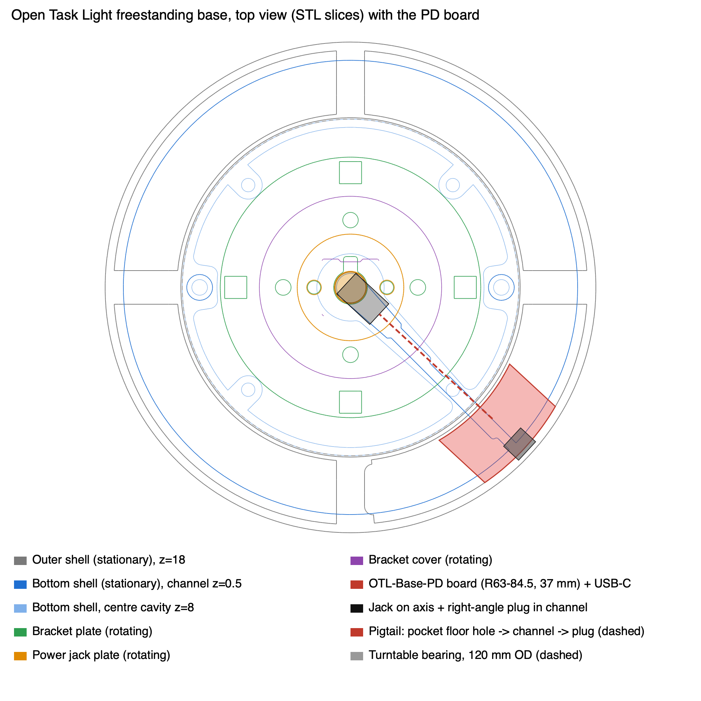

# Mechanical

Printed parts that replace or add to the upstream Open Task Light v1.1 parts. Everything not listed here is the upstream part, printed as the upstream guide says.

| Folder | What it's for |
|---|---|
| `freestanding-base-usbpd/` | The freestanding base, reworked to hold the [USB-PD base board](../electronics/README.md#usb-pd-base-board-otl-base-pd) |
| `electronics-housing/` | Button sockets with pockets the kit buttons fit into |
| `counterweight/` | A lid for the lead counterweight enclosure that goes in |

The STLs are ready to print. The SCAD files (OpenSCAD 2021.01) rebuild them if you change a setting. The base and button-socket files build from upstream's STLs and look for a clone of [upstream](https://github.com/stevenbennett/Open-Task-Light) in the same folder as this repo; set `src` if yours is elsewhere. The counterweight lid doesn't need them. For example, from `freestanding-base-usbpd/`:

```bash
openscad -D 'part="shell"' -o shell.stl freestanding-base-usbpd.scad
```

## Freestanding base for the USB-PD board

Everything in this section is in `freestanding-base-usbpd/`. `freestanding-base-usbpd.scad` builds every part below, picked with `part` (`shell`, `shell_split`, `collar`, `lid`, `bottom`, `cover`, `jack_plate`, `cable_cap`, `bracket_cover`), plus an `assembly` view with `OTL-Base-PD.stl`, the board with its parts, exported with `kicad-cli pcb export stl --subst-models --user-origin 118.5x184.5mm`.

`base-top-view-overlay.png` is the planning drawing: the upstream base parts sliced from their STLs, with the board, jack and lead laid over them.



### Parts

- `freestanding-base-outer-shell_v1.1-usbpd.stl`: a pocket at -45°, the angle of the bottom shell's cable slot. Two 2 mm barriers wall it off from the shot, down to the lid, and it is open from below. The board sits components-up under four 5.5 mm bosses that hang from the chamber ceiling, held by M2 self-tapping screws driven up through the board (1.7 mm pilots, 5.6 mm deep; M2x5 or M2x6, 7 mm max). The USB-C sits 0.5 mm under the pocket ceiling, so its opening, 9.8 x 4.2 mm inside a 12.8 x 7.2 mm recess for the plug overmold, is centred 24.2 mm above the desk. The opening's floor is 0.2 mm under the board's top face (`usb_hole_floor_z`), so the PCB edge doesn't show under the socket. A 0.35 mm groove in the pocket's outer wall (`usb_channel_r`) lets the USB-C nose ride up with the board held 0.45-1 mm towards the centre; it stops 0.5 mm short of the plug recess, so the wall under the socket stays closed and the plug still seats against the receptacle. A 1.8 mm bore runs from the top face straight down to 0.5 mm above D2, in a sleeve hanging from the ceiling; a 9 mm offcut of clear 1.75 mm filament pushed into it is the PG light pipe. The pocket takes about 10% of the shot volume.
- `freestanding-base-outer-shell_v1.1-usbpd-split.stl` and `freestanding-base-outer-shell-collar_v1.1-usbpd.stl` (a pair, instead of the one-piece shell): the same shell split so it prints top face down with no supports, and the top of the base takes the bed's finish. The 10 mm collar round the rail opening is the only thing above the top face, so it's a separate ring (R33.2 to R44), also printed top face down. A 1.3 mm spigot under the collar (R33.2 to R36) drops 0.15 mm loose (`spigot_gap`) into the shell's opening, widened to R36.15 with a chamfer where it meets the bed, and lines the two up; the glued face between them holds the collar. The spigot can't go deeper: the bracket plate turns about 0.4 mm under the shell's 1.4 mm top wall, so it stops 0.1 mm above the wall's underside. The collar's bore is 0.2 mm wider than upstream, so the spigot's clearance can't add up to a rub on the bracket cover. Upside down, the neck lips would overhang the chamber by 2.5-3 mm, so they get 45° slopes on the chamber side (about 6 cm³, roughly 25 g of shot). Both STLs are already in print orientation; what's left to bridge is the nut slots, the lid seats beside the 90°/270° webs (up to 13 mm) and the USB-C opening.
- `freestanding-base-outer-shell-lid_v1.1-usbpd.stl`: an 8 mm notch in the inner edge for the pigtail. Fit it to the half with the pocket; the other lid is the original.
- `freestanding-base-bottom-shell_v1.1-usbpd.stl` and `freestanding-base-cable-cover_v1.1-usbpd.stl` (a pair): where the pigtail turns up into the pocket, the slot is widened to 8 mm (R59 to R70.5, round ends), with a 45° chamfer on the edge it bends round. The old slot stays open to the rim so the lead can slide in from the edge, as upstream. The cover then slides in from the rim along a 1.5 mm dovetail recess in the desk face and sits flush: its key fills the old slot and is held by a crush rib on each side, the plate closes the pass-through under the board, and a 1 mm tongue reaches 8.5 mm into the channel to hold the lead at the bend (room for a lead up to about 4 mm thick). The notch at the rim end is for a fingernail or a small screwdriver. The centre hole has an 11.5 mm counterbore, 2 mm deep (`jack_head_bore_d`, `jack_head_bore_z0`), for the front-mount jack's 9.7 mm head: it can't enter upstream's 8.94 mm hole and would hang only 0.65 mm above it, so any sag in the bearing stack lands it on the ledge. It now has 2.7 mm below it and 0.9 mm all round, so the jack plate's dome touches the collar first (at about 2.4 mm of sag), as upstream. The modified bottom shell needs the cover; the original bottom shell still works without one, but only with the PJ-005A.
- `freestanding-base-power-jack-plate_v1.0-usbpd.stl` and `freestanding-base-power-cable-cap_v1.0-usbpd.stl` (a pair, optional): for a front-mount panel jack (9.7 mm head standing 3.8 mm proud, 7.3 mm thread with flats 6.5 mm apart, 10.6 mm hex nut from the back; the one used here is option NO.3 on [this AliExpress listing](https://www.aliexpress.com/item/1005012757423489.html)) instead of the upstream PJ-005A, which mounts from the back with its nut on the front. The jack goes in from the domed side through a 3 mm wall with a double-D hole, so it can't turn with the plug (the flats face the lead channel, which puts the pins side by side across it, so the + and - wires are the same length), and its head sits on the dome face where the PJ-005A's nut sat (its mouth ends up about 0.3 mm further from the plug). The 1.7 mm nut sits at the bottom of a 19 mm well in the back face, 3.75 mm down, with room for needle-nose pliers or an 11 mm socket. Two stepped 0.4 mm bridge layers let the hole print over the well without support. The cable cap doubles as the nut's spanner: its 15 mm wide end has a hex socket (`cap_socket_gap` 0.15 mm, 1.5 mm deep, so it pushes on the nut and stops 0.2 mm short of the plate), so you tighten the nut by turning the cap, and the wide end reaches to 0.2 mm under the bracket plate, so the cap can't back off the nut once the plate is on. Its 11 mm narrow end covers the pins and solder joints under the rail end (0.45 mm short of it) and lets the lead out through a 3 mm side slot, open at the end and reaching up past the plate's back face. The upstream 0.6 mm marker line on the back is now a 2.4 x 1.2 mm channel (`lead_channel`), so a 2 x 1 mm flat lead lies flush under the bracket plate on its way to the long end of the bracket plate's slot. The head needs the modified bottom shell, whose counterbore leaves it 2.7 mm above the floor and 0.9 mm from the wall, assuming the bearing's rings sit flush. The nut (1.7 mm) and the pins (5 mm long, 0.55 mm thick, 5.75 mm apart centre to centre) are measured; the thread length (about 8 mm under the head) was read off a photo. The pins fit under the cap at their full length, so unlike in the upstream guide, they don't need shortening. Change `jack_wall`, `jack_nut_h` and the `cap_` values if yours differs.
- `freestanding-base-bracket-cover_v1.1-usbpd.stl`: the upstream bracket cover with the channel the two opposite L brackets sit in widened from 9.6 to 10.6 mm (`bracket_channel_half_w`), because they jam in the original. Optional: taking the set screws out of the L brackets lets the original fit too. The 1 mm chamfer along its open edge stays; the third, one-sided channel is unchanged. Prints as upstream.

### Printing

The split shell and collar go on the bed as they load, with no supports, at the upstream shell settings. Set the collar on the shell with its spigot in the opening and glue the faces together with CA glue (superglue) round the whole face, keeping it out of the bore so the bracket cover can turn. Print the rest as the upstream guide says, in the same orientations. The pocket ceiling, the boss ends and the light-pipe sleeve need support; "support on build plate only" reaches them through the pocket's open bottom. The bottom shell prints desk face down as upstream, so the cover recess is on the bed side and its 45° sides need no support. Print the cover flat, desk face down. The jack plate prints back face down like the upstream one, the cable cap closed end down; neither needs support.

### Assembly

1. Solder the pigtail to J2 with the wires entering from the back of the board, so they leave it downwards.
2. With the shell upside down, start the board USB-C end first, tilted about 10° and shifted about 3 mm towards the centre, slide it outwards as it goes in, then push it straight home for the last 14 mm with the USB-C in the groove, slide it about 0.5 mm outwards so the USB-C steps into its opening, and screw it in from the back.
3. Push the filament light pipe in from the top and trim it flush.
4. Test-fit the notched lid (the barrier ends must sit flat on it), tape over the pocket, fill the shot a few mm below the barriers, then peel the tape and check the pocket for stray beads.
5. Route the cable through the lid notch and fit the lid.
6. Fit the bottom shell with its pass-through under the pocket, slide the lead in along the slot from the rim to the pass-through, plug it into the jack and press it into the channel as upstream, then slide the cover in from the rim.

With the front-mount jack: push it into the new plate from the domed side, run the nut on from the back and tighten it by turning the cable cap on it (snug: the body is plastic), and pull the cap off. Before soldering, feed the power cable's free end in through the cap's side slot and out of its hex socket: the Molex connector on the other end won't go through the cap, so it can't go on once the cable is soldered. Solder the cable to the pins at their full length, without shortening them (+ to the centre-pin terminal; check with a meter), then slide the cap down the cable onto the nut with its slot towards the channel on the back face (six positions, 60° apart), lay the lead into the channel, then fit the plate to the bracket plate as upstream.

### Weight

Shot only reaches the pocket through the barrier-to-lid joint, the same flat joint the upstream lids seal with, so use shot of 1 mm or more (S550 as upstream, or lead shot), not sand or grit. With the components facing up, a stray bead would land on the bare back of the board if the base were turned over.

M6 nuts poured in work in place of shot, with no changes to the parts: an M6 is 11.5 mm across its corners, so it passes the outer shell's 13 mm opening any way up (M8 and larger don't). Pour, shake the shell to settle them, top up and repeat. A packing script against the parts' geometry fits 254 M6 nuts (91 in the bottom shell, 163 in the outer shell), about 610 g, against about 1,040 g of S550; poured nuts will settle somewhat below that. 5 mm DIN 934 and 5.2 mm ISO 4032 nuts pack the same 254, and steel and stainless grades all land within about 2% of each other, so buy the cheapest (zinc-plated class 8 DIN 934). A strip of thin foam on each lid should keep them from rattling.

### Also needed

- 4x M2 self-tapping screws for plastic, M2x5 or M2x6 (7 mm max), for the board.
- 9 mm of clear 1.75 mm filament for the light pipe.
- A right-angle DC plug with about 10 cm of lead (up to 4 mm thick), cut from a right-angle extension that matches your jack. The one used here, not yet tried with the front-mount jack, is the 5.5 x 2.1 mm right-angle extension (15 or 20 cm) on [this AliExpress listing](https://www.aliexpress.com/item/1005013033782592.html). The listing doesn't give the wire size; the board's J2 pads take up to 0.5 mm² (20 AWG).
- Shot (see Weight), or M6 nuts.
- A USB-C PD charger with a 20 V profile (most 30 W and up).

## Electronics housing

- `electronics-housing/electronics-housing-button-sockets_v1.0-wide.stl`: the upstream button sockets with bigger pockets from the ledge up: the + and - pockets go from 14.2 to 14.75 mm square (`square_pocket`), the power pocket from 34.2 to 34.65 mm (`round_pocket_d`). The kit buttons measure 14.46 square and 34.2-34.4 round, and the pockets print about 0.12 mm under their drawn size (upstream's 14.2 came out at 14.00-14.15, a 14.6 test at 14.48, both at 100% scale), so these should come out about 0.1-0.25 mm over the buttons; at 0.02 mm over, a button won't go in. The buttons are held in only by friction. The outside, the snap bumps and the ledge are unchanged, so it fits the housing as before. Print at 100% scale (no filament shrinkage compensation), so it still lines up with a housing printed that way, and preferably with the Arachne wall generator: the walls are now 0.525 mm (square) and 0.575 mm (round), which Arachne prints as one line, while classic overlaps two 0.41 mm lines in them (classic drops walls of 0.5 mm or less entirely). `electronics-housing-button-sockets.scad` builds it from the upstream STL. Otherwise prints as upstream.

## Counterweight

- `counterweight/counterweight-lid-lead_v1.0-clearance.stl`: a replacement for the upstream lead counterweight lid, for the unchanged `counterweight-enclosure-lead_v1.0`. The lid goes in tongue first and the screw end swings in, but upstream's 1.3 mm tongue tilts into a slot only 1.5 mm deep, with 0.15 mm all round at the ends and sides. Even in CAD it only goes in at its exact size: 0.05 mm oversize all round and the screw end can't swing in past the lip. The lip and the slot roof also print as bridges when the enclosure stands upright, and sag into that gap. This lid is 11.7 mm wide (0.3 mm a side). It stops 0.55 mm short of the opening at the screw end and 0.35 mm under the lip. The tongue is 1.0 mm thick (`tongue_t`), and the lid has a 0.6 mm chamfer on its outer top edge, 1.5 mm on its inner screw-end edge and 0.3 mm round the bed face. A collision sweep against the enclosure (eight section planes) still finds a way in with the lid 0.2 mm oversize on every face and the lip and slot roof sagged 0.3 mm. The tongue tip, screw hole and countersink are where upstream has them. The thinner tongue lets the top end lift up to 0.5 mm before it catches the lip. Printed and fitted into a printed enclosure. Print it as it lies, inner face down, no supports. To fit: tilt the lid, hook the tongue into the slot, push it up towards the slot, swing the screw end in and let it drop until the holes line up. `counterweight-lid-lead.scad` builds it; `lid-section.png` compares it with upstream's lid.
